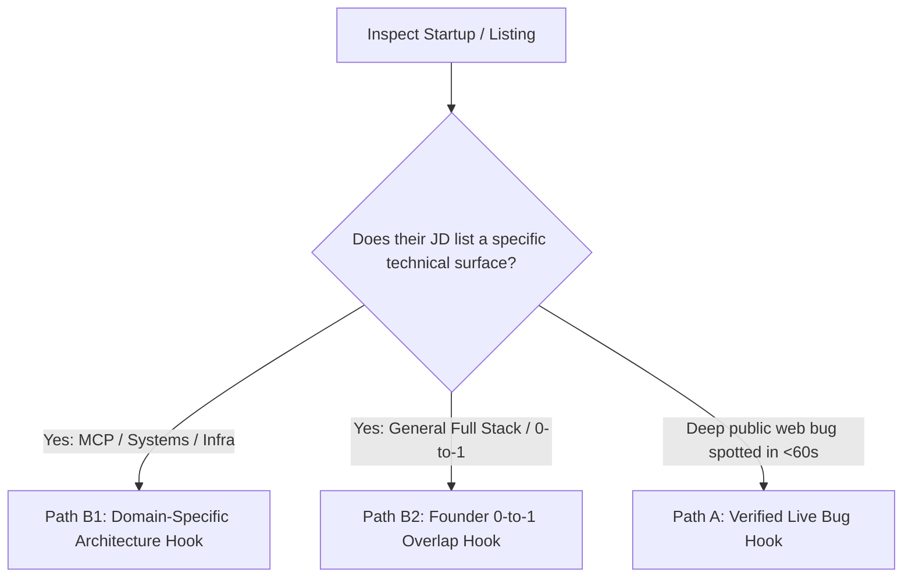

# Universal Grounded Founder Outreach & Application Protocol

A platform-agnostic, evidence-based founder outreach skill designed to maximize response rates from early-stage founders, CTOs, and technical leaders by eliminating AI fluff and leading with direct proof of execution.

---

## 🎯 Core Operating Principles

1. **Proof Over Promises**: Anchor every message to real, live, functional production systems. Never claim abstract "10x speed" without verifiable proof.
2. **Single Proof Anchor (Kill Choice Paralysis)**:
   - Provide **exactly ONE primary proof URL** per message matched to the job type.
   - Never dump 3–4 links at once. A busy founder will click one link; they will hesitate and skip multiple links.
3. **The Anti-Regurgitation Law**:
   - **Never** summarize the founder's own landing page or marketing pitch back to them (*"saw you're building an AI growth hire because distribution is the bottleneck"*). They already know what their company does.
   - Lead directly with authentic builder empathy or their exact engineering requirement.
4. **Cognitive Load & Word Budget**:
   - Hard budget: **Under 55 words total** (fits on a mobile phone screen without scrolling).
   - **Zero Shopping Lists**: Never pad with lists of synonyms (*"API integration, dashboard ticket, or data pipeline"*). Pick ONE concrete problem.
5. **Contractor & Remote Reality**:
   - Explicitly mention timezone/contract terms only when relevant (e.g. billing as an independent contractor under W-8BEN via Deel/Wise/Stripe).
   - "US Remote Only" listings on seed startups frequently accept overseas contractors when proven builders reach out directly with proof.

---

## 🧩 Portfolio Matching Matrix Template

Match the company's domain to **ONE** specific project proof link. Never mix projects into the same sentence:

| Role / Domain Type | Primary Proof URL | Grounded Anchor Narrative |
| :--- | :--- | :--- |
| **Full Stack / Web App / 0-to-1** | `[your-app.com]` | *"worked directly with the founder taking their platform from 0 to 1 into production"* |
| **Forward Deployed / User Discovery** | `[your-product.com]` | *"took [Project] from idea to production talking directly with users and mapping workflows"* |
| **AI Agents / Dev Tools / Systems** | `[your-agent-app.com]` | *"architected [Project], an AI-native execution engine with automated tooling"* |
| **Data Systems / Open Source** | `[your-tool.com]` | *"built and deployed [Tool] end to end from idea to production"* |

---

## 🧭 The Decision Logic



---

## 📜 High-Signal Templates (< 55 Words)

### Path B1: Domain / Systems / AI Infrastructure Hook
*Use when the role involves AI agent tooling, MCP servers, or systems architecture:*

```text
hi [Founder Name],

your thesis on [exact technical problem, e.g. persistent execution for agents] hits home. obsessed over this from first principles—experimenting to see if i could build an AI-native substrate without legacy crutches.

architected [Project Name] with a native tool suite and execution engine:
https://[your-agent-app.com]

i love tinkering at the systems level with high ownership. open to a quick chat?
```

---

### Path B2: Founder 0-to-1 Full Stack Hook
*Use for Full Stack, Product Engineer, or general Founding Engineer roles:*

```text
hi [Founder Name],

having shipped products from 0 to 1 talking directly to users and founders, i know firsthand that building software is the easy part—distribution and clean execution is where products live or die.

took [Project Name] from 0 to 1 directly with high ownership:
https://[your-app.com]

throw me a pending feature from your backlog and i'll build and ship it.
```

---

### Path B3: Forward Deployed Engineer (FDE) Hook
*Use when customer discovery, user feedback, and custom integrations are required:*

```text
hi [Founder Name],

saw you need someone to bridge customer discovery and shipping enterprise agent integrations.

i operate right at that boundary—talking to users, mapping messy workflows, and writing production integrations with high ownership. took [Project Name] from idea to production doing this directly:
https://[your-product.com]

throw me a customer integration from your backlog and i'll build and ship it.
```

---

## 🎯 Context-Dependent Call-to-Action (CTA)

Never use transactional "sprint" language on deep technical roles:

* **For Contract / Backlog tickets**: 
  `throw me a pending feature from your backlog and i'll build and ship it.`
* **For Core Systems / Founding Engineer roles**: 
  `open to a quick chat?` or `would love to chat if you're open to it.`

---

## 🚫 Anti-AI Syntax & Execution Checklist

Before finalizing any message, verify all 6 rules:

- [ ] **Greeting**: Starts with `hi [Name],` (lowercase `hi`, addresses recipient directly).
- [ ] **No Landing Page Summary**: Does NOT tell the founder what their company does.
- [ ] **Word Count**: Strictly **under 55 words**.
- [ ] **Single Proof Link**: Exactly 1 raw clickable URL on its own line (`https://your-domain.com`).
- [ ] **No Attached Parentheses**: Never write `production(https://your-domain.com)`. Keep the URL clean.
- [ ] **No Shopping Lists**: Replaced generic lists with one concrete engineering noun.
